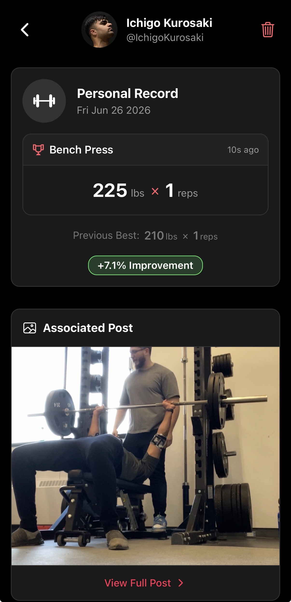
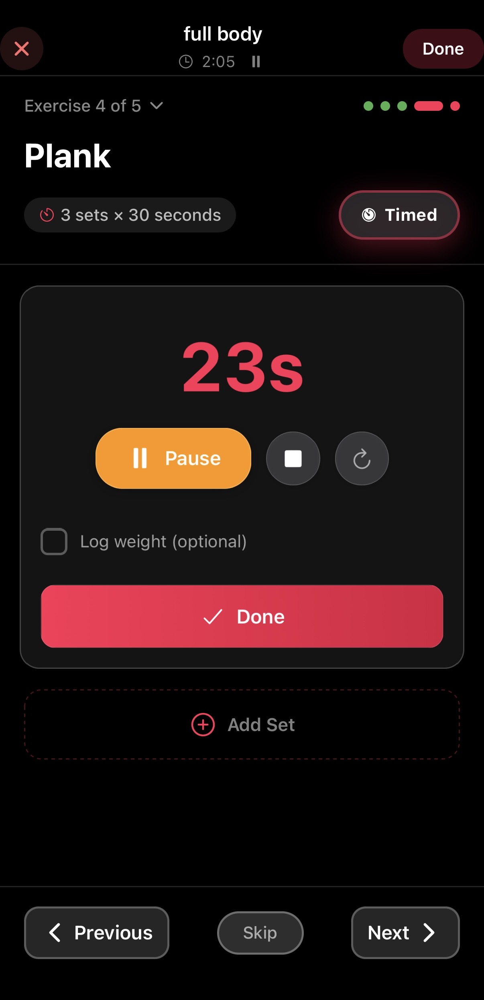

# hlthy

> The intersection of fitness and social media: a cross-platform app where lifters share workouts, track personal records, follow other athletes, chat, and get AI-powered coaching.

<p>
  
  
  
  
  
  
</p>

**hlthy** is a production-grade fitness social network built from a single React Native / TypeScript codebase. It runs on iOS, Android, and web, and is backed by a fully serverless Firebase architecture (Auth, Firestore, Storage, and 70+ Cloud Functions) plus a Python AI coaching service on Google Cloud Run.

---

## 🚀 Live demo

> **Built mobile-first. Best experienced on iOS / Android.**

<!-- APPETIZE PLACEHOLDER: drop the embed link here once the EAS builds are uploaded.
     e.g. ▶️ Try it in your browser (real iOS/Android emulator): https://appetize.io/app/XXXX -->
**▶️ Interactive demo:** _coming soon_. A real iOS/Android build streamed in the browser.

A static web preview is also deployed at **https://hlthy-demo.web.app** (note: the app is designed for mobile; the web build is a convenience preview and some touch-first interactions don't translate to a desktop mouse).

**Demo login** (look around without signing up):

| Email | Password |
|-------|----------|
| `dev3@gmail.com` | `dev1233` |

---

## 📸 Screenshots

<p>
  
  
  
  
  
</p>

---

## What it does

- **Social feed:** share workouts and personal records (PRs); follow athletes; like, comment, and reply.
- **Personalized Explore:** a recommendation grid ranked per-viewer by training-style affinity, engagement, and recency (not a chronological dump).
- **Milestones:** log PRs (1RM, run times, body-composition goals); attach them to posts as achievements.
- **Workout builder & live tracking:** build segmented workouts, then track sets/reps/weights in real time with a rest timer.
- **Archetypes:** users pick a training identity (powerlifter, bodybuilder, crossfitter, athlete, generalist) that personalizes their feed and recommendations.
- **Direct messaging:** real-time DMs with media.
- **AI coaching:** chat-based fitness coaching backed by a Python/Flask service on Cloud Run.
- **Pulse:** an activity/notifications feed (likes, follows, comments) powered by event-driven Cloud Functions + push notifications.

---

## 🛠 Tech stack

| Layer | Technology |
|------|-----------|
| Mobile/Web client | React Native 0.81 · React 19 · Expo 54 · Expo Router 6 (file-based) |
| Language | TypeScript 5.9 (strict mode) |
| Backend | Firebase 11 (Auth, Firestore, Storage) |
| Serverless | 70+ Firebase Cloud Functions (TypeScript, Node 20) |
| AI service | Python + Flask on Google Cloud Run |
| UI | React Native Paper · Reanimated 4 · iOS 26 Liquid Glass tabs |
| State | React Context + Firestore real-time listeners + Async Storage |
| Testing | Jest (jest-expo) + Firestore security-rules tests |
| Tooling | ESLint v10 (flat config, architecture enforcement) · Sentry · EAS |

---

## 🏗 Architecture

The codebase enforces a **strict 3-layer architecture per domain**, with boundaries verified at lint time (CI fails on violation), not just by convention.

```
features/<domain>/
├── domain/   # TypeScript interfaces only (no logic, no imports)
├── infra/    # Repositories: the ONLY layer allowed to import firebase/firestore
└── ui/       # React hooks that consume repositories (no direct data access)
```

A custom ESLint rule (`no-restricted-imports`) blocks any screen, hook, or component from importing Firestore directly; all data access funnels through repository objects. This keeps data-fetching logic testable, swappable, and impossible to leak into the UI layer by accident.

**By the numbers:**

| | |
|---|---|
| Screens / routes | **45+** |
| Feature modules (3-layer) | **13** |
| Cloud Functions | **70+** (28 callable endpoints · 40+ event-driven Firestore/Storage triggers) |
| TypeScript LOC | **~70,000** |
| Automated tests | **80** (unit + security-rules) |

---

## ⚙️ Engineering highlights

**Per-viewer recommendation engine.** The Explore grid is ranked client-side by a pure, unit-tested scoring function:

```
score = archetypeAffinity        (training-style match, [0..1])
      + 0.1·ln(1 + likes)        (log-damped so viral posts don't dominate)
      + 0.2·ln(1 + comments)
      + 0.7·0.5^(ageDays / 7)    (7-day half-life recency decay)
      − seenPenalty + jitter
```

Because archetype affinity is *per-viewer*, the score can't be precomputed into a single stored field, so ranking happens on the client over a fetched candidate pool, with new batches ranked-then-appended (already-displayed items never reorder, so there are no scroll jumps).

**Supply-adaptive feed.** The home feed shows unseen posts first, then demotes already-seen posts into a "best-to-re-show" backfill tier. It self-tunes with no timers or config: when content is sparse the backfill keeps the feed full; as content grows the unseen tier fills every page and recycling naturally stops.

**70+ serverless Cloud Functions.** An event-driven backend handling feed fan-out, engagement counters, a decaying "hype" reputation score, social-graph sync, push notifications (FCM), and automatic image thumbnail generation on upload.

**Real-time & pagination.** Firestore `onSnapshot` listeners for feeds, DMs, and notifications; cursor-based pagination with `startAfter()`.

**Image optimization.** Cloud Functions auto-generate thumbnails (300×300 for posts, 150×150 for avatars); list views use thumbnails, detail views use originals.

**Privacy by design.** GDPR-compliant account deletion cascades across Firestore collections and Cloud Storage via a single declarative target list; locked-down Firestore & Storage security rules with a dedicated rules test suite.

---

## 🧭 Project philosophy

This was built to get the *experience* of real engineering tradeoffs (architecture, scalability, and cost) under production constraints, without startup overhead:

- **Designed to scale, run lean.** The backend uses production-scale patterns (serverless fan-out, precomputed counters, denormalized feeds), while distribution was kept deliberately tight (APK + free-tier Firebase) to keep costs near zero.
- **Validated with a real, tight-knit user group** rather than chasing vanity metrics: a working proof-of-concept that could scale, with the architecture to back the claim.
- **Architecture enforced, not just documented.** Boundaries live in lint rules and tests so they hold up as the codebase grows.

---

## 👥 Team & contributions

A three-person project: **Hashim Bukhtiar**, **Andrew De Rango**, **Nehad Shikh Trab**.

System architecture, the Firebase / Cloud Functions backend (data model, security rules, triggers), and the ranking & feed systems documented above were primarily designed and built by **Hashim Bukhtiar**. AI coaching integration and portions of the iOS interface were contributed by the team.

---

## 📂 Repository structure

```
hlthy/
├── app/             # Expo Router routes (file-based navigation)
├── features/        # Domain modules (domain/ infra/ ui/ per feature)
├── screens/         # Screen components
├── components/      # Shared UI components
├── hooks/           # Application-layer hooks (consume repositories)
├── services/        # Domain-agnostic services (notifications, sharing, …)
├── logic/           # Pure business logic (ranking, hype, formatting); no React/Firebase
├── functions/       # Firebase Cloud Functions (separate Node project)
├── firestore.rules  # Firestore security rules
└── storage.rules    # Cloud Storage security rules
```

---

## ▶️ Running locally

Requires Node ≥ 20.19.4 and a Firebase project (config via `EXPO_PUBLIC_*` env vars, see `.env.example`).

```bash
# Install dependencies
npm install

# Start the Expo dev server
npx expo start            # then scan the QR code with Expo Go

# Platform-specific
npm run ios               # iOS simulator
npm run android           # Android emulator
npm run web               # Web

# Quality gates
npm run lint              # ESLint (enforces architecture boundaries)
npm test                  # Jest

# Cloud Functions (separate project)
cd functions && npm run build
```

---

## 🧪 Testing

```bash
npx jest --watchAll=false        # all tests once (CI mode)
npx jest <path>                  # a single file
```

Covers pure logic (ranking, hype, validation, formatting), repository sanitization, account-deletion cascades, and Firestore security rules.

---

## 📄 License

MIT. See [LICENSE](LICENSE).
